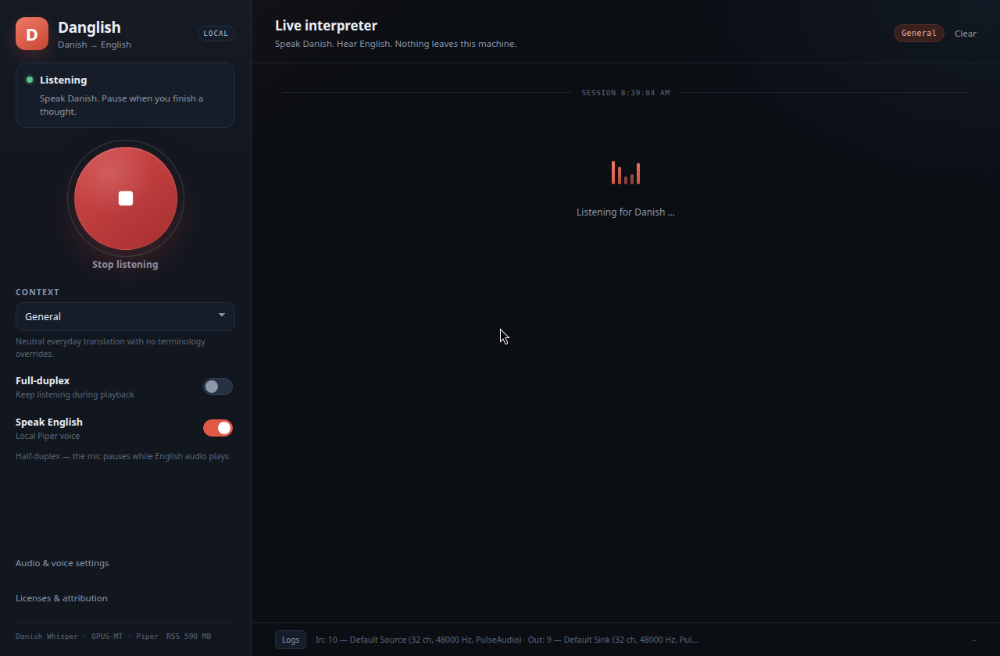

# Danglish

**Local, real-time Danish → English speech-to-speech translation under 2 GB of RAM.**

Speak Danish into your microphone and hear English from your speakers. Everything runs
on your CPU, on your machine: no cloud, no API keys, no telemetry. Danglish is designed
for small PCs, and the whole speech-to-speech stack fits in well under 2 GB of memory.

> **Status:** early but working. The text pipeline and the audio-to-audio path are both
> implemented and tested end to end. Capture, translation, and playback run in parallel;
> it is a turn-based interpreter (speak, pause, hear), not word-level simultaneous
> interpreting. `--full-duplex` keeps listening while the English audio plays.

## Demo

```bash
# 1. Install the speech stack, web demo, and one-time model converter
uv sync --extra speech --extra convert --extra server

# 2. Download and convert the translation model (uses torch once)
uv run --no-sync danglish fetch

# 3. Talk: Danish microphone in, English voice out
uv run --no-sync danglish talk

# With isolated input/output hardware (no acoustic feedback):
uv run --no-sync danglish talk --full-duplex
```

The first run downloads the Danish Whisper small int8 fine-tune (~238 MB), a Piper English
voice (~60 MB), and the OPUS-MT source model; the converted runtime model is ~77 MB. The one-time conversion
also installs torch and keeps the original model in the Hugging Face cache, so budget
roughly 1.5 GB of disk for setup. After that, model loading takes a few seconds. Use
headphones: the microphone is muted while English audio plays, which avoids a feedback
loop.

The converted `models/opus-mt-da-en-int8` directory is self-contained. If you want to run
inference on a machine that should not install torch, convert on a bigger machine and
copy that directory over.

If you use a USB audio interface, run the diagnostic first. It lists stable device names,
records a few seconds, prints per-channel input levels, and plays a test tone:

```bash
uv run --no-sync danglish audio-check
```

No `uv`? With pip:

```bash
python -m venv .venv && source .venv/bin/activate
pip install -e ".[speech,convert,server]" --extra-index-url https://download.pytorch.org/whl/cpu
danglish fetch
danglish talk
```

System dependency for audio on Debian/Ubuntu:

```bash
sudo apt install libportaudio2
```

### Desktop app



The Chromium/Electron app in [`desktop/`](desktop/) is the audio-to-audio UI: a large
start/stop control, live Danish/English captions, context profiles, full-duplex mode, and
audio-device/channel settings. It bundles the Python sidecar and all three models.

For development:

```bash
uv sync --extra speech --extra convert --extra build
uv run danglish fetch

cd desktop
npm install
npm start
```

To build an installer for the current OS (models included):

```bash
cd desktop
npm run dist
```

This produces a Linux AppImage (~700 MB here), a Windows NSIS installer, or a macOS
DMG/zip, depending on the platform. PyInstaller cannot cross-compile the Python sidecar,
so Windows and macOS installers must be built on those operating systems (or with the
`Desktop builds` GitHub Actions workflow). The builds are unsigned by default; macOS will
need right-click → Open until signing/notarization is added.

The model files are platform-independent. Copy `desktop/resources/models/` (~375 MB) from
this machine to a Windows/macOS checkout to test without re-downloading the models; the
desktop app and the installer build both reuse that directory.

### Text mode and web demo

The translator core also runs without audio:

```bash
uv run --no-sync danglish translate "God morgen, hvordan har du det?"
# Good morning, how are you?

uv run --no-sync danglish serve        # http://127.0.0.1:8765 (text UI, no microphone)
```

## How it works

```text
 microphone
     │
     ▼
┌───────────┐   ┌──────────────────┐   ┌────────────────────┐   ┌──────────────┐
│ energy VAD│──▶│ Danish Whisper   │──▶│ OPUS-MT da→en      │──▶│ Piper TTS    │
│ 16 kHz    │   │ small, int8 ASR  │   │ CT2 int8, streaming│   │ English voice│
└───────────┘   └──────────────────┘   └────────────────────┘   └──────┬───────┘
                                                                      │
                                                                      ▼
                                                                  speaker
```

The microphone path is segmented by a small energy VAD. When you stop speaking for
600 ms, the utterance goes through local Whisper ASR, the sentence-aware translation
pipeline, and a local Piper voice. English audio starts playing as soon as the turn is
translated.

Capture/VAD, ASR→MT→TTS, and playback run on separate threads. By default the microphone
is muted during playback (half-duplex) to avoid feedback with laptop speakers. With
isolated audio I/O or an external echo canceller, pass `--full-duplex`: capture and
translation continue while English audio plays, and new turns queue behind the audio that
is currently playing. The models are still used by a single translation worker, so
memory does not increase; on a very small CPU, concurrent work can add a little latency.

The text path uses the same translation core and adds a debounced partial preview of the
sentence currently being written. Speech uses a different default: the **whole ASR turn**
is translated in one call, because a turn is the natural context unit. This fixed
context-dependent errors that sentence-by-sentence translation introduced (for example
“indtalt” → “entered” became “recorded”). Use `--sentence-level` for the old lower-latency
behavior.

See [`docs/architecture.md`](docs/architecture.md) for the streaming algorithm, the
half-duplex audio model, and the memory strategy. Detailed measurements are in
[`docs/benchmarks.md`](docs/benchmarks.md).

### Why these models

- **Danish fine-tuned Whisper small, int8** is a pre-quantized 238 MB model (stock small
  is ~464 MB) and is markedly better on Danish: the model card reports WER 0.078 vs 0.234
  for stock small on a 21.5 s clip, and our own 20 s sample improved from “Diversionen …
  Danielen … encyklibedi” to “Det er versionen … indtalt … bruger Daniel … encyklopædi”.
  It runs at roughly 14× real time on the test machine.
- **Helsinki-NLP/opus-mt-da-en** is a 77M-parameter Marian model, converted to
  CTranslate2 int8 (~77 MB). It is a strong small general-purpose baseline, not a
  state-of-the-art translator.
- **Piper en_GB-alba-medium** is a 63 MB English voice that synthesizes at roughly 20×
  real time on CPU and is licensed CC BY 4.0.

## Measured footprint

Measured on a 32-core x86_64 development machine, Python 3.12, CTranslate2 int8,
4 inference threads, beam size 2. RSS is process resident memory; latency will vary by
CPU. Reproduce with `danglish bench` and `scripts/speech_smoke.py`.

| Configuration | Weights on disk | Peak RSS | Notes |
|---|---:|---:|---|
| Text translation | ~77 MB | **147 MB** | 10-sentence corpus, p50 36 ms |
| Text + web server | ~77 MB | **185 MB** | FastAPI/uvicorn after model load |
| Full speech-to-speech | ~375 MB | **~1.0 GB** | Danish ASR + MT + Piper, multi-turn |
| Hard budget | — | **2,048 MB** | target for the whole process |

Full-duplex uses the same models and bounded audio queues; its memory footprint is
unchanged. The extra cost is CPU contention with playback, which is small because
playback itself is cheap.

The **CLI** is the leanest option. The Electron desktop app adds roughly 0.6 GB across its
Chromium processes (summed RSS; shared pages are counted more than once), so a loaded
window is around 1.1–1.2 GB and an ASR-heavy turn can approach 1.5 GB. It still fits under
2 GB, but with less headroom for the OS. On a strict 2 GB machine, measure with
`ps`/Task Manager and prefer `danglish talk` if the desktop shell is too close to the
limit. See the screenshot and build notes in [`desktop/`](desktop/).

Measured turn latency for a 20-second Danish audio clip:

| Stage | Time | Real-time factor |
|---|---:|---:|
| Danish Whisper small ASR | 1.46 s | ~14× real time |
| OPUS-MT translation | 0.15 s | — |
| Piper speech synthesis | 0.38 s | ~30× real time |
| **Total** | **~2.0 s** | for 20 s of input |

With the default 600 ms end-of-speech pause, expect roughly **1–2 seconds from “stop
speaking” to English audio** for short utterances, plus playback time. The first run
downloads models; subsequent process startups load them in a few seconds.

The 20-second clip above was one continuous utterance. When the VAD splits the same clip
into five turns, total processing is ~5.4 s (five Whisper calls, each with fixed
overhead) and peak RSS is ~1.0 GB. The Danish fine-tune handles short fragments much
better than stock small (the 1 s fragment is now “Solen.” rather than “Såt.”), but the
fixed ASR cost still dominates. Tune `--silence-ms` and `--min-energy` for your
microphone and speaking style.

### Fitting under 2 GB

The full stack peaks at about 1.0 GB (999 MB observed in the Danish-ASR multi-turn run),
leaving roughly 1 GB of headroom for the OS and other applications. If you need to go
lower:

- `danglish talk --asr-model base` lowers ASR memory but hurts Danish accuracy.
- Use `configs/small-pc.toml` (2 threads, greedy decoding) on a 2–4 core machine.
- The text-only pipeline is ~150 MB if you do not need audio.

`danglish doctor` reports an estimate against the 2 GB budget, and `danglish bench`
fails if measured peak RSS exceeds it. `danglish talk` prints the speech-stack RSS after
loading.

## CLI

```text
danglish talk                     microphone → Danish ASR → English speech (alias: mic)
danglish talk --full-duplex       keep listening while English audio plays (isolated I/O)
danglish talk --no-tts            microphone → Danish ASR → English text only
danglish talk --list-devices      list audio devices
danglish audio-check              list devices, measure input levels, play a test tone
danglish devices                  list audio devices and defaults (used by the desktop UI)
danglish translate "text" | -f file | -        one-shot text translation
danglish repl                     interactive line-by-line text translation
danglish stream                   incremental stdin → stdout, with partials
danglish serve                    local text WebSocket demo + web UI
danglish contexts                 list translation context profiles
danglish fetch                    download + convert the OPUS-MT model
danglish doctor                   environment, dependency, and memory checks
danglish bench                    text latency and peak-RSS benchmark
```

Model and performance options live in [`configs/default.toml`](configs/default.toml).
Useful overrides:

```bash
danglish talk --asr-model small --tts-voice en_GB-cori-high
danglish talk --min-energy 0.008 --silence-ms 500
danglish talk --sentence-level    # lower latency, less context
danglish talk --input-device "Volt 4" --output-device "Volt 4"
danglish talk --full-duplex --input-device "Volt 4" --output-device "Volt 4"
danglish talk --input-channel 1     # microphone on UAD input 2
danglish talk --stats               # ASR/MT/TTS timings per turn
danglish talk --json                # machine-readable turns, still speaks
danglish talk --context sermon      # church terminology profile
danglish translate --context sermon "Menigheden samledes søndag."
```

Every option can be overridden on the command line (`--model-path`, `--compute-type`,
`--threads`, `--beam-size`) or with `DANGLISH_MODEL` / `DANGLISH_CONFIG`.

## Speech quality and limitations

- **It is turn-based.** The VAD waits for 600 ms of silence before cutting the utterance,
  and Whisper transcribes the whole utterance. There is no partial ASR, so very long
  monologues wait for the full segment (max 15 s).
- **Half-duplex by default, full-duplex available.** The mic is muted during playback by
  default to protect laptop users. With isolated input/output, `--full-duplex` never
  mutes: capture and ASR/MT/TTS continue while the previous English audio plays.
  Playback is still serialized, so new translations queue behind the audio currently
  playing. This is parallel processing, not overlapping English speech.
- **Small-model quality.** The Danish Whisper fine-tune is much better than stock small,
  but it still makes occasional mistakes; OPUS-MT is a compact 77M model and remains the
  quality ceiling for translation. Proper names, numbers, and domain terms are the usual
  failure points. Check the printed Danish transcript first: if it is wrong, the error is
  ASR; if it is right, the MT is at fault.
- **One speaker, one stream.** The design is a local interpreter, not a multi-user
  meeting transcriber.

### Full-duplex with isolated audio

If your interface keeps the microphone and speaker signals separate, use:

```bash
# First: verify devices, channels, levels, and monitoring
danglish audio-check

# Then: keep listening while English audio plays
danglish talk --full-duplex --input-device "Volt 4" --output-device "Volt 4" --stats
```

Device indices can change when PipeWire nodes come and go, so device **names** are the
stable choice. `audio-check` marks the desktop-default input/output and prints per-channel
RMS/peak levels. A UAD Volt 4 normally exposes input 1 as channel 0 and input 2 as
channel 1; select the latter with `--input-channel 1`. Outputs 3/4 can be selected with
`--output-channel 2 --output-channels 4`.

The runtime now opens the interface at its native rate (typically 48 kHz) and resamples to
16 kHz for the VAD/ASR, and it writes playback through an explicit output stream rather
than `sd.play()` (which can hang on multi-channel PulseAudio interfaces). If the test tone
is audible but your speakers are on another output pair, change `--output-channel`.

### If the interface input is silent

`danglish audio-check` is the first thing to run. If all channels are silent or very
quiet:

- confirm the microphone is on input 1 or 2, not a line input;
- raise the hardware gain knob (aim for speech RMS around 0.02–0.1 in `audio-check`);
- enable 48V phantom power for a condenser microphone;
- if the mic is on input 2, add `--input-channel 1`;
- if the device only streams a fixed channel count, add `--input-channels 4` (or the
  count reported by `audio-check`).

The default VAD threshold is 0.006 RMS. A very quiet but clean interface can use
`--min-energy 0.003`; check that the level display stays quiet when nobody is speaking,
otherwise the VAD will trigger on noise. For a UAD, the hardware monitor/volume knob must
also be up to hear the test tone and the English output.

The capture callback keeps feeding the VAD while playback runs. A new Danish turn can be
recognized, translated, and synthesized while the previous English sentence is still
playing; its audio is queued in order. The translation worker is intentionally
single-threaded so turns do not reorder and only one copy of each model is loaded.

This is not yet word-level simultaneous interpreting: Whisper still waits for the VAD to
close an utterance, so 600 ms of silence (or a 15 s maximum segment) is required before a
new translation starts. Streaming ASR with partial hypotheses is the next latency step;
see the roadmap. On a 2–4 core machine, overlapping ASR with playback can add a little
latency, but memory stays flat because the models are shared.

## Translation quality

The biggest speech-quality bug was not the MT model: it was the ASR. Stock Whisper
`small` produced “Diversionen … Danielen … encyklibedi” on our test clip. The default is
now the MIT-licensed Danish Whisper small fine-tune, which produces “Det er versionen …
indtalt … bruger Daniel … encyklopædi” with the same runtime class. It also runs behind a
Silero speech-presence gate, so silence and noise no longer produce hallucinated words.

The second improvement is context: speech now translates the whole ASR turn, not one
sentence at a time. This fixed “indtalt” → “entered” (sentence-level) vs “recorded”
(whole-turn). Use `--sentence-level` only when latency matters more than context.

The translation model itself remains a 77M OPUS-MT model. We tested the 228 MB
`opus-mt-tc-big-gmq-en` on 1,000 OPUS-100 da→en sentences: BLEU 40.61 vs 40.82 for the
77M model, at roughly half the throughput. A bigger generic model was not a free win.
For a specific domain such as sermons, the high-leverage path is a small evaluation set
plus a domain fine-tune; see [`docs/context.md`](docs/context.md). The `sermon` profile
already applies conservative terminology preferences.

## Context profiles

A setting such as “church sermon” cannot be given to the current 77M OPUS-MT model as an
instruction — it has no prompt channel. Danglish implements the part that is reliable
today: conservative terminology preferences, applied only when the Danish source contains
the corresponding term.

```bash
danglish contexts
# general    General
# sermon     Church / sermon

danglish translate --context sermon "Menigheden samledes søndag."
# The congregation gathered on Sunday.
```

The `sermon` profile prefers *congregation*, *sermon*, *pastor*, *worship service*,
*Holy Communion*, *the Holy Spirit*, and *Savior*. It deliberately skips ambiguous cases,
such as a source that mentions both *menighed* and *kirke* (congregation and building).

This improves consistency, not general discourse understanding. The real quality step is
a domain fine-tune: the 77M model can be fine-tuned on sermon data, converted to
CTranslate2, and selected by a profile at the same inference size. The plan, evaluation
method, and trade-offs are in [`docs/context.md`](docs/context.md).

## Repository layout

```text
src/danglish/
  segmenter.py         Danish-aware incremental sentence splitting
  pipeline.py          streaming translation events and document translation
  backends/            CTranslate2 backend + mock backend
  speech.py            ASR → MT → TTS orchestration (device-free, testable)
  tts.py               Piper voice loading, download, and synthesis
  audio/
    vad.py             energy VAD
    asr.py             faster-whisper wrapper
    runtime.py         parallel capture / translation / playback runtime
    mic.py             microphone capture, playback, talk loop
    util.py            resampling and WAV helpers
  server/              FastAPI WebSocket server + text UI
desktop/               Electron UI, settings, packaging scripts
packaging/             PyInstaller sidecar spec
scripts/
  speech_smoke.py      WAV file → English WAV, no microphone needed
  bundle_models.py     assemble the desktop model bundle
tests/                 unit tests + integration tests (marked `integration`)
```

## Models and licenses

Danglish code is **Apache-2.0**. Models and voices are downloaded separately and keep
their own licenses:

| Component | Model | License |
|---|---|---|
| Translation | `Helsinki-NLP/opus-mt-da-en` | Apache-2.0 |
| ASR | `lucasw89/whisper-small-danish-ct2-int8` (Danish fine-tune of OpenAI Whisper small) | MIT |
| TTS voice | Piper `en_GB-alba-medium` | CC BY 4.0 (voice dataset) |
| TTS runtime | `piper-tts` (optional) | GPL-3.0-or-later |

The default Piper voice is downloaded at runtime, not bundled. `piper-tts` is an
optional GPL dependency installed only by the `speech`/`tts` extras; the Apache-2.0 core
does not require it. See [`NOTICE`](NOTICE) and [`docs/models.md`](docs/models.md) for
attribution, licensing details, and alternatives. The TTS voice choice is configurable;
if you switch voices, check that voice's license.

## Roadmap

- [x] Streaming text pipeline + Danish sentence segmentation
- [x] CT2 int8 backend and model conversion
- [x] WebSocket text demo
- [x] Local microphone → English speech pipeline (ASR + MT + TTS)
- [x] Parallel capture, translation, and playback
- [x] Full-duplex mode for isolated audio I/O
- [x] Electron desktop UI with bundled models and a Python sidecar
- [ ] Signed/notarized Windows and macOS installers
- [ ] Browser microphone + server-side audio-to-audio (web UI)
- [ ] Streaming/partial ASR for lower latency
- [ ] Acoustic echo cancellation for shared speaker/microphone setups
- [x] Conservative context/terminology profiles (`general`, `sermon`)
- [ ] Sermon-domain fine-tune and evaluation set
- [ ] Quality evaluation harness (FLORES-200 / CoRal samples)
- [ ] Prequantized packaged ASR/TTS artifacts for faster first run
- [ ] Optional higher-quality English voices

## Contributing

Issues and pull requests are welcome. Please read [`CONTRIBUTING.md`](CONTRIBUTING.md)
first. The short version: keep the runtime lean, add tests, and report memory numbers
with performance changes.

## License

Apache-2.0. See [`LICENSE`](LICENSE).
